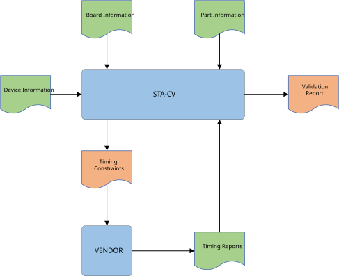

Process
=======

Commands
--------

Each step of the process is a stacv command: a verb, then what it acts on.

.. code-block:: text

   stacv create template interface --output interface.toml
   stacv visualize edges interface.toml
   stacv generate xdc interface.toml --output interface.xdc
   stacv generate report_tcl interface.toml --output interface_stacv_report.tcl
   stacv check interface.toml

Run ``stacv`` alone to list the commands.
A command given without its arguments, or with a wrong one, prints its help and then the error, so each next word can be found from the terminal.

Check output
------------

``stacv check`` prints the files it reads, and a result for every port of the interface, in the order of the ``[[port]]`` tables:

.. code-block:: text

   Reading interface file interface.toml
   Reading timing report file timing_reports/O_DAC_DATA_timing.rpt
   PASSED: O_DAC_DATA.SDR-SS-O
   Reading timing report file timing_reports/O_DAC_SDEN_F_timing.rpt
   FAILED: [s5_slack_001] O_DAC_SDEN_F.SDR-SS-O-FLC
       timing_reports/O_DAC_SDEN_F_timing.rpt:14  setup slack -10.295ns
   DEFERRED: I_DAC_DATA.SDR-SS-RT

* ``PASSED:`` every rule of the port passed.
* ``FAILED:`` one line for each failing rule, followed by its details, each indented four spaces with the file and line it comes from.
  Rules skipped because an earlier stage failed are not printed.
* ``DEFERRED:`` the port has ``status = "defer"``, and is not checked yet.

Each result names the port as ``<port>.<methodology>``, the same identifier as in the ``--report`` and ``--junit`` files, so it can be searched for in a CI log.
Paths are shown relative to where stacv runs; the ``--report`` file keeps them in full.
When every port passes, the last line is ``Check Passed``.
