Process
=======

.. The diagrams name the files generically (interface file, not spi_config.toml), as there is more than
   one kind of interface.  Each diagram's Mermaid source is next to its SVG in img/process; render one with
   mmdc -i img/process/<name>.mmd -o img/process/<name>.svg

stacv sits on either side of the timing tool.
It writes what goes into Vivado, the constraints and the script that reports their timing, and it checks what comes out, the timing reports.
The constraints are never written or reviewed by hand: the inputs are small text files of facts, and every constraint is derived from them.

Every interface goes through the same seven steps.

1 Gather Inputs
---------------

Collect what the next steps need before any file is written:

* the HDL, from the designer: the clocks, the ports, the registers that drive and capture them, and when the design changes each signal;
* the part's datasheet, from its manufacturer: the setup, hold and clock to out of each pin, and the fastest clock it allows;
* the trace delays, from the hardware engineer: the shortest and longest delay of each trace.

2 Create Templates
------------------

``stacv create template`` writes the interface, part and traces templates (see :doc:`commands`).
For an interface pattern such as SPI, the command line gives the mode and the clock periods, and the templates have every edge already set for the mode, with comments that give each edge's time.
Each value still to fill in is a placeholder, ``FROM_DESIGN_...`` or ``FROM_DATASHEET_...`` named after its key, which stacv stops on, so nothing is left at a guess.

3 Create Input Files
--------------------

Fill in the three templates, each from its own input:

* **Update Part**: the part file takes each pin's timing from the datasheet, with its symbol and where it is in the datasheet (see :doc:`part`).
* **Update Interface**: the interface file takes the names of the clocks, ports and registers from the HDL, and when the design launches and captures each signal, with the line of the HDL it comes from; the mode comes from the datasheet.
  For SPI, the interface file is the SPI configuration (see :doc:`spi_config`); stacv expands it into the full interface file whenever it runs.
* **Update Traces**: the traces file takes the delay of each trace from the board (see :doc:`traces`).

The three files are linked by the interface's signals, such as COPI and CS, not by names, so each can be written by whoever owns its input.
They are text a reviewer can read: the facts and the few judgements in them, with where each comes from.

4 Validate Input Files
----------------------

Before the timing tool runs, draw what the files say and compare it with the design and the datasheet:

* ``stacv visualize edges`` draws each port's launch and capture edges and its setup and hold requirements; compare them with the datasheet's timing diagrams and with when the HDL changes each signal.
* ``stacv visualize block_diagram`` draws the registers, ports, traces and part pins of each path; compare it with the design (see :doc:`block_diagram`).

These take seconds, and catch the mistakes that are plausible in a file and plain in a picture: a data input and output swapped, or a chip select timed to the wrong edge.

5 Generate Constraints
----------------------

``stacv generate xdc`` writes the constraint file, and ``stacv generate report_tcl`` the script that writes a timing report for each port (see :doc:`generate`).
The constraint file explains every constraint: where each number comes from, and why each option is there.
It is not edited: a change is made in the input files, and the constraints are generated again.

6 Generate Timing Reports
-------------------------

Add the constraint file to the design, implement it in the timing tool, and source the report script after routing.
The script writes one timing report file for each port, with every path of the port in every corner.
How the timing tool is run is the project's own flow; stacv needs only the constraint file read in, and the report script sourced after routing.

7 Validate Timing Reports
-------------------------

``stacv check`` reads the timing reports and checks them against the input files: that every path starts and ends where the interface says, that the timing tool applied each constraint as intended, and that the slack is not negative (see :doc:`check_output`).
It prints PASSED or FAILED for each port, with the worst slack of a passed port and the rule, file and line of each failure, and it can write a report file and a JUnit file for a CI system.

A failure is fixed in the input files or the design, never in the constraint file, and the process runs again from the step that changed.

After the process
-----------------

The timing is met and checked.
:doc:`eye` shows where the data sits in each port's window, to move a capture edge for more margin, and :doc:`datasheet` gives the interface's timing at the device's pins, for whoever connects a part to it next.
